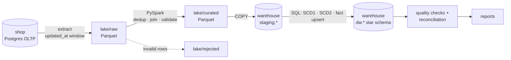

# Orders-to-Warehouse Batch Pipeline

A daily batch ELT pipeline that moves e-commerce orders from an application database into a
star-schema data warehouse, through a partitioned Parquet data lake and a PySpark transform.

It is built around four guarantees rather than just moving rows:

- **Nothing is lost.** A source-to-target reconciliation proves that warehouse line counts and revenue match the source exactly.
- **Nothing is double-counted.** Every step is idempotent, so any day can be re-run or backfilled safely, in any order.
- **History is preserved.** Customers are tracked as SCD Type 2, so revenue stays attributed to the city a customer lived in *when they ordered*.
- **Bad data is stopped.** Invalid rows are quarantined, and quality checks fail the run instead of letting bad data reach reports.

---

## Architecture



One run processes one **run date** in four steps: `extract → transform → load → quality`.

| Component in this project       | AWS equivalent                                    |
|---------------------------------|---------------------------------------------------|
| Postgres database `shop`        | Amazon RDS (OLTP source)                          |
| `lake/` folder (raw, curated)   | Amazon S3 bucket with zone prefixes               |
| `extract.py`                    | AWS Glue job / Lambda / DMS                       |
| `transform.py` (PySpark)        | Spark on Amazon EMR, or an AWS Glue ETL job       |
| Postgres database `warehouse`   | Amazon Redshift                                   |
| `COPY` into `staging.*`         | Redshift `COPY ... FROM 's3://...' FORMAT PARQUET`|
| `run.py`                        | Airflow (MWAA) or AWS Step Functions              |
| `sql/reports/`                  | Amazon QuickSight / Athena                        |

## Tech stack

Python 3.12 · PySpark 4.0 · PyArrow / Parquet · PostgreSQL 16 · psycopg 3 · pytest · Docker Compose

---

## Project structure

```text
orders-pipeline/
├── docker-compose.yml          # Postgres + pipeline container
├── Dockerfile                  # Python 3.12 + Java 17 + dependencies
├── requirements.txt
├── pytest.ini
├── docker/init/
│   └── 01_create_warehouse_db.sql
├── sql/
│   ├── source_schema.sql       # OLTP tables (customers, products, orders, order_items)
│   ├── warehouse_schema.sql    # staging.* and dw.* star schema, dim_date generation
│   ├── load/                   # run in name order inside one transaction
│   │   ├── 01_dim_product.sql          # SCD Type 1 upsert
│   │   ├── 02_dim_customer_scd2.sql    # SCD Type 2: expire + insert
│   │   └── 03_fact_order_line.sql      # version-aware delete-then-insert, point-in-time join
│   └── reports/
│       ├── 01_daily_revenue.sql
│       ├── 02_revenue_by_city_as_was_vs_as_is.sql
│       └── 03_top_products_per_category.sql
├── pipeline/
│   ├── config.py               # settings from environment variables
│   ├── db.py                   # database connections
│   ├── lake.py                 # Parquet read/write, partition layout
│   ├── source/                 # seed + day simulator for the fake shop
│   ├── extract/extract.py      # OLTP -> lake/raw
│   ├── transform/              # PySpark: lake/raw -> lake/curated (+ rejected)
│   ├── load/load.py            # lake/curated -> staging -> dw
│   ├── quality/checks.py       # quality checks + source-to-target reconciliation
│   ├── run.py                  # orchestrator with gap guard and resume
│   └── report.py               # prints the analyst reports
└── tests/
    └── test_transform.py       # unit tests for the Spark logic
```

---

## Getting started

**Prerequisites:** Docker Desktop (on Windows, with the WSL 2 backend). Nothing else needs to be
installed locally; Python, Java and Spark live in the container.

```bash
docker compose up -d --build          # first build takes a few minutes
docker compose exec pipeline bash     # open a shell inside the pipeline container
```

Postgres is published on `localhost:5433` (user `postgres`, password `postgres`) for tools such as
DBeaver or pgAdmin.

> On Windows, keep the project outside OneDrive-synced folders (e.g. `C:\dev\orders-pipeline`).
> Sync clients interfere with the many small files Spark writes.

## Running the pipeline

All commands run inside the `pipeline` container.

```bash
# Create the fake shop and simulate its first day of business
python -m pipeline.source.seed --date 2026-10-01
python -m pipeline.source.simulate_day --date 2026-10-01

# Run the whole pipeline for that day
python -m pipeline.run --date 2026-10-01

# Next days: customers move city, prices change, earlier orders ship or cancel
python -m pipeline.source.simulate_day --date 2026-10-02
python -m pipeline.run --date 2026-10-02

# Analyst reports
python -m pipeline.report

# Unit tests
pytest -q
```

Useful options:

```bash
python -m pipeline.run --date 2026-10-02 --from-step load   # resume after fixing a failure
python -m pipeline.run --date 2026-10-05 --allow-gap        # override the missing-day guard
```

Each step can also be run on its own:

```bash
python -m pipeline.extract.extract     --date 2026-10-01
python -m pipeline.transform.transform --date 2026-10-01
python -m pipeline.load.load           --date 2026-10-01
python -m pipeline.quality.checks
```

---

## Data model

**Grain of the fact table: one row per order line** (one product on one order). This is the lowest
grain the source provides, so it can roll up to orders, customers, products or days without losing
detail.

| Table                | Type                 | Notes |
|----------------------|----------------------|-------|
| `dw.fact_order_line` | Fact                 | Measures `quantity`, `unit_price`, `line_amount`; `order_id` kept as a degenerate dimension; `order_updated_at` records the source version |
| `dw.dim_customer`    | Dimension, SCD Type 2 | One row per *version* of a customer, with `valid_from`, `valid_to` and `is_current`; a partial unique index enforces one current version |
| `dw.dim_product`     | Dimension, SCD Type 1 | Overwritten in place. Price history isn't needed here because the price actually paid is stored on the fact |
| `dw.dim_date`        | Dimension            | Generated (2026–2027), not extracted |
| `dw.pipeline_runs`   | Run log              | One row per load, used by the gap guard |

Facts reference dimensions by **surrogate keys**. `customer_id` identifies a customer;
`customer_key` identifies one *version* of that customer. The fact load uses a **point-in-time
join** so each order line points to the customer version valid when the order was placed.

---

## How correctness is enforced

### Idempotency at every hop

| Step      | Mechanism |
|-----------|-----------|
| Extract   | Window derived from the run date (`[date, date+1)` on `updated_at`); the partition is replaced, not appended |
| Transform | Deduplicates to the latest version per key; Spark writes with `mode("overwrite")` |
| Load      | Staging is truncated each run; everything runs in **one transaction** |
| Dimensions | SCD1 upsert with a recency guard; SCD2 creates a version only when a tracked attribute `IS DISTINCT FROM` the current one, and never lets an older batch expire a newer version |
| Fact      | **Version-aware delete-then-insert** on `order_item_id`: a row is replaced only by the same or a newer source version, so re-running an old day cannot revert `shipped` to `placed` |

### Data quality checks (run after every load; any failure stops the pipeline)

1. No duplicate order lines (the grain is unique)
2. Every staged order line reached the fact table (no rows silently dropped by key lookups)
3. Every customer has exactly one current version
4. Customer versions never overlap in time
5. `line_amount = quantity × unit_price`
6. No zero or negative quantities in the fact table
7. Order status is one of the known values
8. **Source-to-target reconciliation:** line count and revenue in `shop` equal those in the warehouse

Checks 1–7 prove the warehouse is *consistent*; check 8 proves it is *complete*.

### Other safeguards

- **Quarantine:** order lines with invalid quantities go to `lake/rejected/` instead of being dropped silently.
- **Gap guard:** `run.py` refuses to process a date if the previous day was never loaded (re-running older dates is still allowed).
- **Explicit schemas:** the raw zone has a typed contract (decimals for money, microsecond timestamps), so source type changes fail loudly.

---

## Design decisions and trade-offs

- **Incremental extract on `updated_at`**: cost scales with what changed, not table size. The trade-off is that it cannot see hard deletes or rows written without bumping `updated_at`; reconciliation detects the latter.
- **Raw zone kept untouched**: if a transform bug is found, data can be reprocessed from the lake without touching the source database again.
- **Parquet**: columnar, compressed, self-describing; analytical queries read only the columns they need.
- **Broadcast join in Spark**: `orders` is the smaller side, so it is broadcast to every executor and the larger side is never shuffled.
- **Staging + SQL merge**: mirrors how Redshift is loaded (`COPY` into staging, then SQL), and keeps the load atomic.
- **Postgres stands in for Redshift**: the SQL carries over. On Redshift, primary and foreign keys are not enforced (hence the quality checks), and the fact table would use `DISTKEY(customer_key)` and `SORTKEY(date_key)`, with `DISTSTYLE ALL` for the small dimensions.

## Known limitations and next steps

- **Write-audit-publish:** checks currently run after the load commits, so bad data is briefly visible. Next step: run the fact checks against staging inside the load transaction, before commit.
- **CDC instead of `updated_at`:** capture deletes and every intermediate change by reading the database log (AWS DMS).
- **Per-day reconciliation**, so a failure points directly at the broken day.
- **AWS edition:** lake on S3, schemas in the Glue Data Catalog, ad-hoc queries with Athena, failure alerts via Lambda + SNS.

---

## Troubleshooting

| Problem | Fix |
|---------|-----|
| `database "warehouse" does not exist` | The init script only runs on an empty volume: `docker compose down -v`, then `docker compose up -d` |
| Port 5433 already in use | Change `"5433:5432"` in `docker-compose.yml` |
| `ModuleNotFoundError: pipeline...` | Check file names and that every package folder has an `__init__.py`; run commands as `python -m ...` from `/app` |
| A load step doesn't appear in the output | Files in `sql/load/` must end in `.sql` and are run in name order |
| `Gap detected` | Run the missing day(s) first, or pass `--allow-gap` |
| Start from scratch | `docker compose down -v`, delete `lake/`, `docker compose up -d` |

---

**Author:** Shreyash Khare